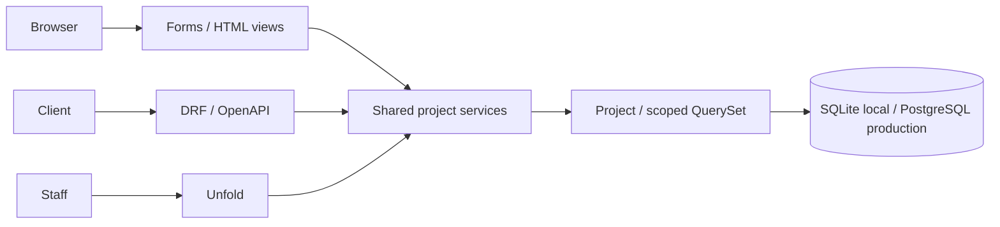

# Architecture

Modular monolith: satu database dan satu web application, dengan HTML dan DRF adapters yang memakai shared domain operations. Unfold merupakan staff interface dan tetap mengikuti ownership scope serta Django model permissions.

`create_project` validates and saves trusted owner/draft. Its optional unsaved instance exists specifically for Django admin save_model, so form object identity remains coherent. `update_project` locks and re-fetches scoped object, preventing adapters from setting owner/status. `transition_project` validates supported state graph inside atomic; repeated target is a no-op. Active identity is checked at the shared boundary as well as login.

ProjectQuerySet.visible_to returns none for anonymous/inactive, own records for normal actors, global records for superusers. Superuser global access is a deliberate starter policy. Staff without project permissions cannot access custom overview/actions; staff does not imply global data access. Identity/role management is superuser-only even when ordinary staff receives auth model permissions accidentally.

Transport validation resides in Form/serializer; domain calls full_clean and database check constraints protect direct invalid name/status writes. DjangoValidationError maps to HTTP 400 at the DRF adapter; unexpected exceptions remain server errors. HTML preserves bound validation inputs. No hard delete, network side effects, or invisible background work occurs.

Settings local reads .env; test isolates DB/hashers/email; production does not read developer .env and requires injected secrets/DB/hosts. APP_MODE determines route/app surfaces, not model ownership or migrations. Config factories avoid settings import-time circular references and do not query DB.

Static assets: source static + Unfold/sidecar package assets → collectstatic compressed manifest → WhiteNoise. Uploaded media is not static and is not publicly exposed by this starter. Production WSGI uses Gunicorn; ASGI entrypoint is available for a deliberately chosen ASGI server but starter sync transaction APIs remain sync.

Tests cover domain, HTML/session/CSRF, API, admin and PostgreSQL locks. Any added tenant, provider, queue, audit or deletion capability must extend all relevant entrypoints and negative paths. Use existing app layout until responsibility growth justifies splitting modules.
