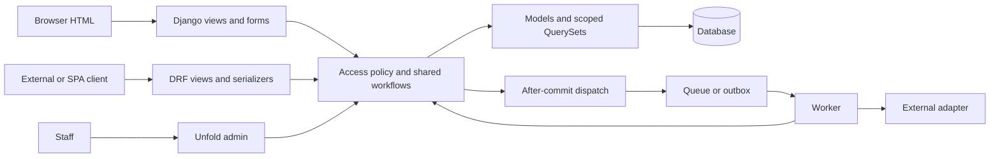

# Architecture and code

Use for domain/model changes, ORM, migrations, transactions, and Python organization. These are skill recommendations, not a mandatory Django directory layout.

## Smallest coherent architecture

Default to a modular monolith and apps named for business capabilities. Preserve existing layout. A new app may start with models, views, forms, URLs, admin, migrations, tests, and namespaced templates/static. Add `api/`, `services.py`, `selectors.py`, or `tasks.py` only when responsibilities emerge.

| Responsibility | Default home | Split when |
|---|---|---|
| Persistence and single-object behavior | Model | Workflow spans objects/integrations |
| Reusable reads/aggregations | QuerySet/manager | Complex selector merits a name |
| HTML validation | Form/ModelForm | Rule is shared by other entrypoints |
| JSON contract | DRF serializer | Multi-step write delegates to workflow |
| HTTP rendering/status | View | Repeated orchestration appears |
| Multi-step transition | Explicit function/service | Shared by API, HTML, task, admin |
| Presentation | Template/include/tag | Stable markup repeats |

Use a function for a simple endpoint and generic views where they remove duplication. Explain invariants/reasons in comments, not the obvious code. Type public workflow boundaries where useful; keep existing formatter, linter, and type tooling. Avoid generic repositories that duplicate the ORM.

Django favors loose coupling, cohesive layers, explicit behavior, minimal boilerplate, and presentation-only templates; these do not mandate a service layer everywhere. [Design philosophies](https://docs.djangoproject.com/en/6.1/misc/design-philosophies/)

## Data modeling

- Select relation deletion behavior (`PROTECT`, `SET_NULL`, `CASCADE`) from business lifecycle. Use real foreign keys for database relationships, not strings masquerading as them.
- Use `DecimalField` for money, defined rounding/currency, `TextChoices`/`IntegerChoices` for bounded states, aware timestamps, and requirements-driven locale/timezone. Use `JSONField` for flexible payloads, not every queryable relationship.
- Enforce durable uniqueness/checks with constraints. Index actual predicates/joins/orderings; avoid speculative index proliferation.
- New projects expecting identity customization should establish `AbstractUser`/`AUTH_USER_MODEL` before initial migrations. Existing user-model swaps require migration planning. Use `settings.AUTH_USER_MODEL` in relations and `get_user_model()` at runtime. [Auth customization](https://docs.djangoproject.com/en/6.1/topics/auth/customizing/)
- `save()` does not run `full_clean()`, and bulk operations bypass save hooks/signals. Validation needs deliberate entrypoints plus database protection against races. [Model instances](https://docs.djangoproject.com/en/6.1/ref/models/instances/)

## Query and authorization design

Scope before lookup, pagination, aggregates, or export. Make access policy reusable across HTML/API/admin/tasks. A submitted tenant ID is not membership proof. Scope FK/autocomplete choices and reject unauthorized relations.

Profile first. Use explicit `select_related("customer")` for suitable single-valued relations and `prefetch_related("items")` for collections, bounded pagination, database aggregation, and `exists()` for existence. Watch expensive counts, duplicate joins, serializer/template relation access, and deferred-field queries. Compare query growth across list sizes. [ORM optimization](https://docs.djangoproject.com/en/6.1/topics/db/optimization/)

Avoid evaluated global querysets/import-time DB access. Raw SQL uses bound values and allowlisted identifiers. Cache keys include relevant tenant/authorization dimensions; avoid publicly caching private responses and invalidate after successful writes.

## Transactions and external effects

Use `atomic()` for changes that commit together. Acquire `select_for_update()` inside transactions where serialized transitions are required. Conditional `update()` and `F()` expressions can protect expected-state writes/counters. Catch `IntegrityError` outside the failing atomic block/savepoint and map only recognized constraint failures. Keep slow network calls outside locks.

`on_commit()` prevents dependent work from running before commit but cannot atomically guarantee external broker delivery. Use an outbox where durable delivery matters. Prefer explicit business transition calls over signals that hide order or miss bulk paths. Define retry/idempotency/timeouts for external effects as required. [Transactions](https://docs.djangoproject.com/en/6.1/topics/db/transactions/)

## Migrations

Commit model/migration changes together. Data migrations use historical `apps.get_model()` and the migration DB alias, not current models. For large/live tables assess locks, defaults/nullability, reversibility, and expand/backfill/contract compatibility. Do not rewrite applied history or delete data merely to make migrations pass. [Migrations](https://docs.djangoproject.com/en/6.1/topics/migrations/)

Verify engine-specific constraints, JSON, locks, and indexes using that database. SQLite success does not prove PostgreSQL concurrency or PostGIS behavior.

## Async and jobs

Keep ordinary sync Django/DRF unless async I/O helps the actual path. In Django 6.1, transactional work still belongs in a synchronous function called via `sync_to_async`; use supported async ORM methods elsewhere. Disable persistent DB connections in async mode per the pooling design. Never suppress design errors with `DJANGO_ALLOW_ASYNC_UNSAFE`. [Async support](https://docs.djangoproject.com/en/6.1/topics/async/)

Django Tasks defines task/queue/backend APIs but no production worker itself. Choose a backend and running infrastructure, or retain Celery. Pass primary keys and minimal validated context rather than model/request objects. [Tasks](https://docs.djangoproject.com/en/6.1/topics/tasks/)

## Memilih arsitektur produk

| Situasi | Arsitektur awal | Kapan berkembang |
|---|---|---|
| Internal CRUD/small product | Django modular monolith + templates + Unfold | Tambah API/jobs ketika klien/workflow membutuhkan |
| Mobile/external consumers | Modular Django backend + DRF + OpenAPI + Unfold | Versioning/client contracts bila breaking changes perlu |
| Rich browser application | Django domain + DRF + chosen frontend | Pisahkan deployment/ownership frontend bila bermanfaat |
| Collaborative realtime | ASGI + authorization + Channels bila perlu | Channel layer, backpressure, connection lifecycle |
| High-volume integrations | Explicit adapter + queue + idempotency | Outbox/retries/reconciliation ketika delivery penting |
| Banyak domain/tim | Apps dengan boundaries jelas | Extract service hanya dengan alasan scaling/ownership nyata |

Microservices, event sourcing, CQRS, atau generic repository bukan baseline Django. Pilih hanya bila problem dan biaya operasionalnya diketahui. “Clean architecture” tidak berarti semua ORM harus disembunyikan di wrapper; separation of concerns bisa tercapai dengan native Django dan beberapa workflow functions.

## Diagram responsibility dan deployment

Deployment sederhana dapat satu web service + satu database + static via WhiteNoise. Queue/Redis/object storage/CDN ditambahkan sesuai volume/persistence/delivery. Web dan worker bisa berbagi image/source dengan process entrypoint berbeda. Definisikan trust boundary reverse proxy, browser origins, object storage public/private, dan provider credentials.

## Batas domain dan kebijakan

Tuliskan aturan kepemilikan/state dalam bahasa bisnis sebelum membuat models: siapa dapat membaca, membuat, mengubah, menyetujui, membatalkan, menghapus, atau mengekspor; dari state mana; invariant apa harus bertahan jika API/admin/import memanggilnya. Jangan menempatkan aturan hanya pada UI.

Service/use case dapat menerima actor, identifiers, dan typed values. Ia memeriksa bisnis/ownership, memuat object, menjalankan transaction, menyimpan hasil/audit, dan menjadwalkan side effects bila diperlukan. Adapter mengelola authentication, transport validation, HTTP codes/messages, redirects, dan renderer. Tidak semua CRUD butuh service; wajibkan shared operation ketika rule harus konsisten pada beberapa entrypoints.

Model method cocok untuk perubahan satu object bila semua caller memahami persistence/transaction contract. QuerySet policy menyaring data; policy function mengecek capability. Hak read dan write dapat berbeda, jadi `visible_to()` bukan otomatis izin approve/delete. Nama policy harus menyatakan semantik tersebut.

## Multi-tenant secara sengaja

| Strategi | Cocok untuk | Konsekuensi |
|---|---|---|
| Shared tables + tenant FK | Banyak aplikasi bisnis dengan operational simplicity | Setiap query/write/choice/cache/job/export wajib tenant scope |
| Separate schema | Isolation/administration kebutuhan spesifik | Migration per schema, connection switching, extensions/tooling |
| Separate DB | Isolation/regulatory/operational requirements kuat | Provisioning, connection routing, migrations/backups per DB |

Shared-table default bukan pengganti analisis requirement. Resolve current tenant dari authenticated membership dan trusted context, bukan body/header saja. Unique constraint sering perlu `(tenant, business_key)`; relation target harus same-tenant; task context mengandung tenant identifier yang diverifikasi. Dashboard/search/autocomplete/export/cache harus mengikuti policy yang sama. RLS dapat menambah defense bila infrastrukturnya mendukung, tetapi connection/session setup harus benar; jangan mengklaim isolation karena tenant column sudah ada.

Uji actor A tenant A terhadap list/detail/action/FK tenant B, termasuk admin dan background/export paths. Global operator access harus grant eksplisit, diaudit, dan tidak muncul hanya karena `is_staff` true.

## External boundaries dan error mapping

Satu adapter per provider/capability mengatur timeout, request schema, response parsing, transient/permanent errors, signature/auth, dan redaction. Workflow memutuskan retry/compensation/idempotency, bukan membiarkan library exception bocor ke browser. Dependency injection hanya pada boundary yang perlu test doubles atau implementasi alternatif; jangan membuat interface untuk setiap function.

Tetapkan error domain yang membedakan invalid transition, duplicate business key, forbidden capability, dan upstream unavailable. HTML mengubahnya ke field/non-field errors/messages; API ke documented errors/status; worker ke retry/failure semantics. Catch exception sempit; unexpected failures tetap dilog tanpa secret dan tidak disamarkan sebagai success.

## Lifecycle schema dan operasional

Soft delete hanya jika lifecycle/audit/recovery membutuhkannya; jelaskan uniqueness, visibility, retention, restore, dan references. Audit event berbeda dari mutable timestamps; simpan actor/subject/transition/reason bila diperlukan. Data protection/retention requirement harus dinyatakan pengguna, bukan diasumsikan dari package history.

Untuk large migrations, pisahkan schema expansion, bounded backfill, code switching, dan constraint cleanup. Storage uploads memerlukan orphan/failed-upload strategy sesuai volume. Reconciliation berguna bila provider dan database dapat berbeda state; jangan mengasumsikan transaction lokal mencakup network/provider.

## Architecture record yang cukup

Simpan keputusan penting pada docs existing: mode fullstack/API, app boundaries, auth/tenant policy, data/state diagram, transactions/concurrency, provider/worker boundaries, static/media, deployment entrypoints, dan verification path. Gunakan satu ADR untuk tradeoff yang sulit dibalik; jangan membuat dokumen besar untuk edit kecil. Struktur kode lengkap dan contoh berada pada [folder guide](folder-and-code-structure.md) dan [vertical slice](vertical-slice.md).
